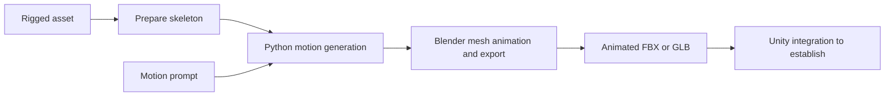
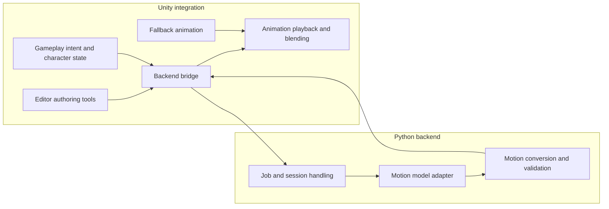

# Unity Animation Horizon

Status: vision draft for review
Date: 2026-10-20

## Vision

Build toward a Unity package that lets game developers generate and control character animation through a Python motion backend. Begin with useful animation clips that work with Unity's animation system. Explore progressively more responsive generation until practical limits become clear.

The ultimate target is an experiment, not a promised deliverable. Reaching only the earlier horizons is a worthwhile result if those tools help real projects. Progress depends on evidence rather than fixed dates.

## Ultimate experience

A developer installs a Unity package, connects a supported character, and describes or supplies movement intent. Unity sends generation requests and relevant character state to a Python backend. The backend returns motion that Unity can play and blend with its existing animation system.

At the furthest horizon, characters respond during gameplay to changing intent and constraints, with continuous motion and acceptable latency. This may resemble procedural animation or IK from the developer's perspective. It does not assume that UniMate already provides a per-frame IK solver, contact handling, or a responsive motion controller.

Python owns model inference. Unity owns gameplay decisions, scene integration, animation application, and fallback playback. A small C# integration layer is expected; the model itself need not be rewritten in C#.

## Starting point

This repository provides Python motion generation, preparation of custom rigs, and a Blender-based path for animating assets into GLB or FBX. Unity import quality, runtime inference performance, and gameplay responsiveness remain unproven in this project.

## Horizons

Horizons describe increasing capability. They are not commitments to a fixed architecture, schedule, or final level of quality. Each horizon should leave a usable result before exploration moves further.

| Horizon | Capability | Evidence needed to advance | Useful result if progress stops here |
|---|---|---|---|
| H1: Prove the asset path | Generate one motion for one supported rig and import it into Unity | Correct bone motion, orientation, scale, timing, and root motion behavior on the chosen character | A documented Python-to-Unity animation workflow |
| H2: Make an authoring tool | A Unity Editor package submits jobs to Python, shows progress and failures, and imports generated clips | Repeatable generation and import without manual repair of every result; clear setup and failure recovery | An animation authoring package for supported rigs |
| H3: Make outputs useful in games | Produce, review, and organize clips for actual character use; improve looping, transitions, and root motion handling where feasible | A small representative animation set plays through a real Animator setup with understood quality limits | A practical clip generation and preparation workflow |
| H4: Explore generation during play | Unity requests motion from a running Python process and plays completed motion through a buffer | Measured latency, throughput, memory use, cancellation behavior, and fallback playback on declared hardware | A runtime demonstration with buffered motion generation |
| H5: Explore responsive continuous motion | Replan or extend motion as intent changes while preserving continuity | Useful response time, stable transitions, manageable contact artifacts, and predictable behavior under repeated control changes | A constrained interactive motion prototype |
| H6: Trial in a real project | Integrate the best proven capability into one representative game scenario | Acceptable visual quality, resource cost, reliability, packaging, and developer workflow in that scenario | A validated integration with explicit supported cases and limitations |

H1 through H3 are the first practical product direction. H4 through H6 are research horizons whose feasibility must be established. Findings may change their order or require a different model.

## Architecture direction

Keep the Unity-facing contract separate from the current model implementation. Start with files and batch jobs; introduce a persistent service only when the workflow or runtime experiments justify it. Choose the transport after requirements are measured.

The early bridge exchanges exported assets and job results. A later bridge may exchange motion chunks with skeleton identity, timing, pose conventions, root motion, and request identity. Those contracts need an implementation design when their horizon is selected.

## Questions to resolve through experiments

- **Rig compatibility:** Begin with one explicit rig category. Measure what changes for another skeleton before claiming broad support. The current preparation workflow also imposes a joint-count limit that must be respected.
- **Motion fidelity:** Track bone mapping, rest pose, axes, units, frame rate, root motion, foot sliding, contacts, and import differences separately.
- **Control:** Determine which intent and constraints the model actually supports. Text prompts alone may be insufficient for gameplay control.
- **Continuity:** Test whether motion chunks can be extended or joined without visible jumps. Smooth blending alone may not correct inconsistent movement intent or contacts.
- **Performance:** Measure generation time and its variation, model startup, data transfer, frame application cost, and memory on named hardware. Do not claim real-time capability before these measurements.
- **Deployment:** A local Python backend is the initial direction. How a player build obtains and manages Python, model weights, GPU dependencies, or a remote service remains an open deployment decision.
- **Use rights:** Before real-project adoption, review applicable code, model, input-asset, dataset, and distribution terms for the chosen workflow.

## Decision points

After each horizon, record what worked, what failed, the environment used, and the strongest remaining limitation. Then choose to advance, improve the current tool, narrow supported cases, replace a component, or stop at the useful result already achieved.

If live generation is too slow, buffered or offline generation remains valuable. If responsive control requires capabilities the current model lacks, investigate a different backend or hybrid approach rather than treating the Python bridge as the solution to model limitations. Unity's existing animation and IK systems can remain part of a hybrid design.

## Working agreement

- Keep this document as the horizon vision; update it when experiments change the direction.
- Select and design one bounded milestone at a time. Create executable implementation plans separately under `.cursor/plans/implement/`.
- Set concrete acceptance criteria for the selected milestone, using measured baselines rather than invented performance promises.
- Preserve a working tool at each horizon. A useful offline authoring workflow counts as success even if continuous runtime generation never becomes practical.
- This vision does not authorize building all horizons or choose the next milestone. That discussion follows review of this document.
