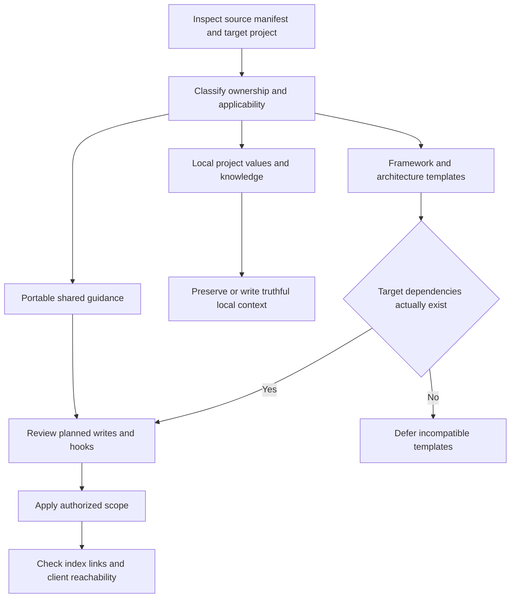
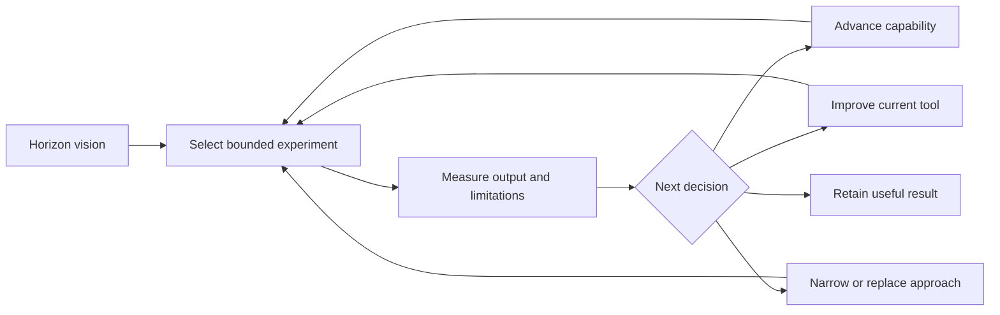

# Playbook: Project Setup and Python-to-Unity Exploration

Project-owned procedure derived from the 2026-10-20 setup session. For current decisions and artifacts, read [project memory](../memory/mem-project-context.md). This playbook records reusable methods, not authorization to execute every step.

## Start with actual state

Inspect the working tree, current branch, remotes, applicable agent instructions, installed tools, and requested scope. Reuse prior user authorization. Do not treat a successful local configuration change as proof of an external account action or remote publication.

```powershell
git status --short
git branch --show-current
git remote -v
```

## Configure fork ownership

Use `origin` for the user's fork and `upstream` for the public source when that matches the user's request. Inspect existing names before adding or renaming remotes. Fork creation on GitHub, changing local remotes, creating a local branch, and pushing commits are distinct operations; report each accurately.

Fetching is a read-only way to inspect available upstream updates. Choose the actual upstream branch and merge/rebase policy before integration; do not issue a generic pull against an assumed `main` or `master`, and do not overwrite user work.

## Adopt shared AI guidance into a different project type



1. Read source README, manifest, sync implementation, settings, and template inputs. A folder named shared does not imply every file applies to every consumer.
2. Compare target reality: Python package, Unity project, installed package set, architecture, and client adapters. Never invent assembly names, Unity versions, locator services, or file paths to satisfy an unrelated template.
3. Use the established sync preview/apply workflow when it supports the approved scope. If it cannot filter incompatible content, explicitly document selective adoption and its update limitation. Do not call a one-time file copy an automatic sync link.
4. For a fresh portable adoption, copy only manifested Universal destinations and applicable settings after reviewing them. Preserve local files and omit unrelated templates. An existing consumer needs conflict/retirement review before replacement; a fresh-install recipe is not an upgrade recipe.
5. Inspect hook commands, their environment assumptions, and their referenced files. Do not copy another project's permission allow-list or credentials.
6. Keep Universal copies intact. Store consumer lessons in Project memories, values, and playbooks. Propose shared improvements at source separately.
7. Check both integrity and reachability. A zero-finding checker can skip an absent memory registry; a hook can exit successfully while emitting no context. Claude hooks do not automatically run in other clients.

Current consumer limitation: the standard shared script requires Unity identity configuration and includes an unrelated templated playbook. This project adopted the portable subset only. Review scope before a future update.

## Route memory and procedures

Use `.cursor/memory/mem-arch-assemblies-canonical.md` as the single two-column registry expected by the installed hook. Its filename is a compatibility contract; its contents should describe the actual Python project. Put Project registrations inside `LOCAL-MEMORY-INDEX` boundaries. Use a compact `HUB:` row to route to durable context.

Record decisions, rationale, artifact links, measured evidence, unresolved questions, and historical observations separately. Avoid a verbatim transcript, credentials, or claims that an unexecuted command succeeded. Keep detailed reference material in docs and reusable procedures in this playbook directory.

After memory changes:

```powershell
node .claude/tools/ai-audit/check-ai-index.js --project .
```

Also inspect relevant Markdown links and actual hook output. The checker does not validate every playbook or memory-body link.

## Write a Python project reference from evidence

Read root and subsystem docs, then trace executable entry points, configuration schema, factories, dataset transforms, sampling, saved formats, and export wrappers. Keep shell invocation, model inference, preview rendering, and asset export as distinct operations.

Explain internal arrays precisely. In this project, sampled features need recovery and matching conditioning; they cannot be applied directly as Unity bone transforms. Preserve checkpoint/config/statistics identity and motion/manifest/mesh identity.

Use diagrams for pipeline and architecture relationships, tables for module ownership and formats, and source links for details. Check relative paths from the actual document directory. Distinguish source-supported behavior from workstation verification. Documentation-only work does not require installing dependencies or running a costly model.

## Plan by horizons, then bounded experiments

Frame the ultimate vision as aspirational when the user says so. Give each horizon a useful output, evidence needed to advance, and a fallback if progress stops. Avoid invented dates or latency targets.



Do not conflate cross-language communication with model capability. A Python bridge transports data; it does not create responsive control, contact handling, or IK. Establish offline rig-to-clip correctness before relying on an interactive runtime design. Existing chunk expansion is a research starting point, not proof of stable gameplay control.

Save vision and design documents under `.cursor/plans/design/`, executable plans under `.cursor/plans/implement/`, and use `YYYY-MM-DD-<topic>.md`. The established Python reference lives under `docs/`. Keep exact technical prose in artifacts even when conversation uses terse language.

## Report outcomes precisely

State which files changed, what was checked, and what remains unverified. Examples from this session: remotes configured versus fork created; shared files copied versus ongoing sync configured; index clean versus all client policies reachable; commands documented versus generation executed. Ask only for a missing decision that affects the next authorized action.
