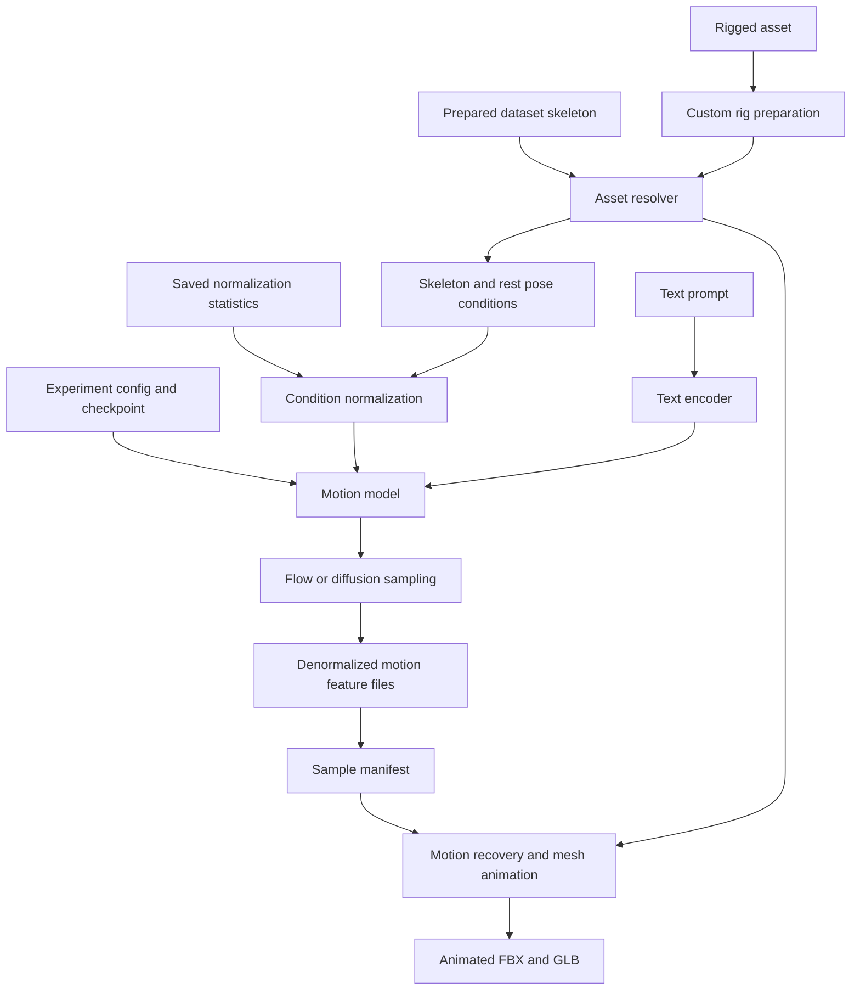
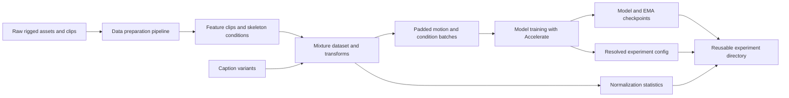
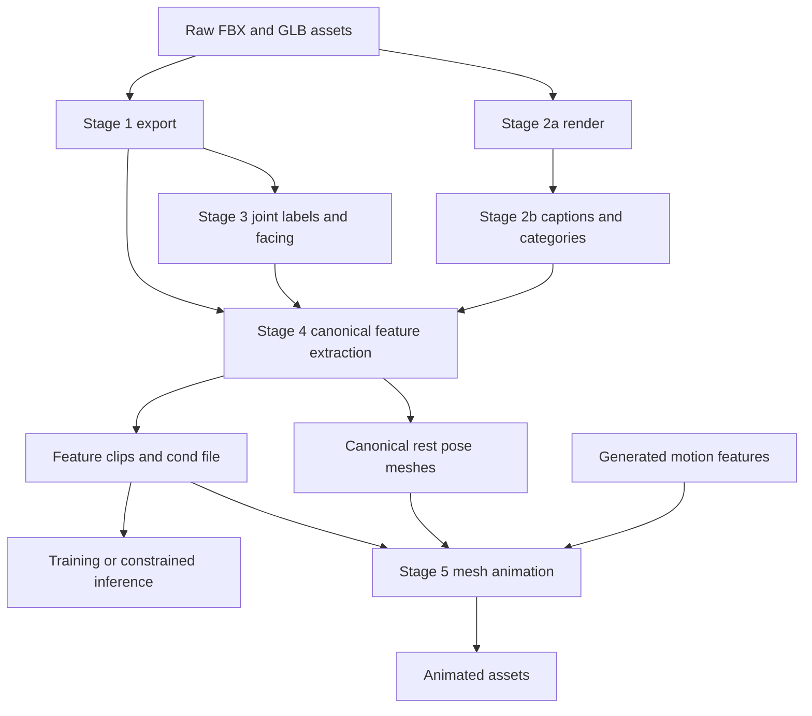
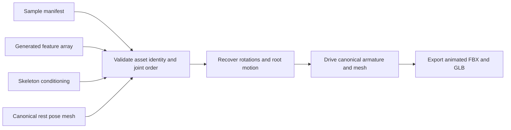
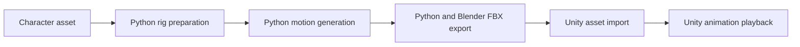

# UniMate Python Project Guide

This document describes the Python side of the current UniMate checkout: what it does, how its modules fit together, how to run its workflows, and what its outputs mean. It is intended for developers maintaining this fork and building a future Unity integration.

The description is based on repository source and existing documentation inspected on 2026-10-20. Commands below are reference workflows, not evidence that dependencies, GPU support, model downloads, or generation have been tested on this workstation. Where a detailed upstream guide already exists, this document links to it rather than duplicating every command-line option.

## Contents

- [Purpose and current boundaries](#purpose-and-current-boundaries)
- [Repository map](#repository-map)
- [Architecture and execution flow](#architecture-and-execution-flow)
- [Environment and dependencies](#environment-and-dependencies)
- [Assets, skeletons, and motion formats](#assets-skeletons-and-motion-formats)
- [Model architecture](#model-architecture)
- [Data-processing pipeline](#data-processing-pipeline)
- [Preparing a custom rig](#preparing-a-custom-rig)
- [Generating motion](#generating-motion)
- [Constrained generation](#constrained-generation)
- [Mesh animation and export](#mesh-animation-and-export)
- [Training and configuration](#training-and-configuration)
- [Operational guidance and troubleshooting](#operational-guidance-and-troubleshooting)
- [Boundary for future Unity integration](#boundary-for-future-unity-integration)
- [Source-reading map](#source-reading-map)

## Purpose and current boundaries

UniMate generates articulated motion conditioned on a skeleton and, for text-conditioned models, a prompt. Its conditioning represents the skeleton's structure, rest pose, and joint semantics so a model can work across different body plans. Inputs can come from prepared datasets or a custom rigged asset.

The repository has two closely connected systems:

1. **Motion learning and generation:** dataset loading, motion feature construction, text encoding, model construction, training, and inference under `unimate/`.
2. **Asset and data preparation:** Blender export, rendering, captions, joint annotation, canonicalization, and mesh animation under `data_process/`.

Existing workflows are command-line and file based. There is no implemented Unity package, Unity `AnimationClip` importer, persistent Python generation server, or Unity gameplay protocol in this checkout. The upstream README describes generation as real time; responsiveness in a Unity gameplay loop, including loading, transfer, playback, and changing constraints, still needs to be measured for this fork's use case.

The long-term integration direction is recorded in the [Unity Animation Horizon](../.cursor/plans/design/2026-10-20-unity-animation-horizon.md).

## Repository map

| Path | Responsibility |
|---|---|
| `unimate/configs/schema.py` | Typed configuration objects, defaults, validation, and JSON loading/saving |
| `unimate/dataset/factory.py` | Dataset and dataloader construction |
| `unimate/dataset/mixture/` | Unified motion dataset, topology augmentations, and batch collation |
| `unimate/dataset/transforms.py` | Cropping, conditions, normalization, padding, and parent features |
| `unimate/dataset/conditioning.py` | Sampling conditions consistent with the training pipeline |
| `unimate/models/factory.py` | Denoiser and diffusion/flow factories |
| `unimate/models/denoiser/` | Full and graph attention models with adaLN or cross-attention text conditioning |
| `unimate/models/text_encoder/` | T5, CLIP, and BERT text encoder interfaces |
| `unimate/models/flow/` | Flow-matching paths, transport losses, and numerical integration |
| `unimate/models/diffusion/` | Gaussian diffusion implementation and schedules |
| `unimate/training/` | Training entry point, trainer, EMA, and progress tracking |
| `unimate/inference/` | Asset resolution, sampling, guidance, and constrained motion generation |
| `unimate/utils/` | Rotation/geometry operations, feature recovery, topology, caching, logging, and previews |
| `unimate/tools/precompute_text_emb.py` | Offline text embedding preparation |
| `data_process/motion_export/` | Source asset and animation export into intermediate NPZ files |
| `data_process/motion_rendering/` | Motion and rest-pose rendering |
| `data_process/vlm_caption/` | Motion captioning, caption rewriting, and category classification |
| `data_process/joint_annotation/` | Joint vocabulary, name cleaning, and facing selection |
| `data_process/feature_extraction/` | Canonical features, skeleton conditioning, and canonical assets |
| `data_process/rig_preprocess/` | Guided preparation of one custom asset using the dataset pipeline |
| `data_process/mesh_animation/` | Motion recovery, mesh driving, canonical rig handling, and export |
| `data_process/tools/` | Inspection, repair, conversion, and visualization utilities |
| `data_process/utils/` | Shared Blender, kinematics, skeleton, topology, and asset helpers |
| `configs/` | Eight supplied training recipes: four dataset selections, each with two model variants |
| `scripts/` | Top-level Bash wrappers for training, sampling, and animation export |
| `data_process/scripts/` | Bash wrappers for individual data-processing stages |
| `assets/examples/` | Prepared custom examples and sampling case definitions |
| `requirements.txt` | Unified pinned dependency environment |

## Architecture and execution flow

### Inference and asset export



The sampler loads an experiment's architecture and weights. The asset resolver supplies the skeleton; the text encoder supplies prompt features. Sampling produces motion features. Those features are saved with a manifest linking them back to the exact asset. The mesh-animation stage uses this relationship to drive the correct canonical mesh.

### Training



An experiment is more than a checkpoint. Its resolved configuration and normalization statistics are needed to reconstruct the model and interpret its inputs and outputs consistently.

## Environment and dependencies

### Baseline setup

Run Python commands from the repository root so imports and relative paths resolve consistently.

```bash
conda create -n unimate python=3.10 -y
conda activate unimate
pip install "setuptools<81"
pip install -r requirements.txt --no-build-isolation
```

The `setuptools` restriction and disabled build isolation support the legacy `Motion` dependency, whose build imports `pkg_resources`. Follow the repository's installation recipe before changing these constraints.

The pinned environment targets Python 3.10 with CUDA 12.4 PyTorch wheels. Important dependencies include:

| Dependency | Role |
|---|---|
| PyTorch and torchvision | Model execution, training, and text encoder dependencies |
| torch-geometric | Optional graph embedding support |
| torchdiffeq | Flow ODE/SDE integration |
| Accelerate | Device handling, distributed training, and mixed precision |
| transformers, sentencepiece, CLIP | Text encoders and local language/vision models |
| spaCy and its English model | T5 text normalization |
| Motion | Animation, quaternion, and kinematics utilities |
| `bpy==4.0.0` | Blender operations inside Python |
| huggingface_hub | Model/dataset downloads through `hf` |
| openai and google-genai | Optional remote annotation/caption backends |
| NumPy, matplotlib, imageio | Data arrays, plots, and animation previews |
| tyro | Inference command-line parsing |

The requirements file includes the PyTorch CUDA wheel index and Blender's Python wheel index. Availability of the pinned wheels on a particular OS must be checked during installation; this document does not establish native Windows compatibility for the complete stack.

### Python, Blender, and Bash are separate requirements

- Custom rig preprocessing uses the environment's `bpy` module and does not require a separate Blender executable for that path.
- Dataset export and animation wrappers can use `blender -b`; the pipeline guide lists Blender on `PATH` for those stages.
- EEVEE rendering uses the pip `bpy` module under plain Python, because it needs that module's GPU context.
- `.sh` wrappers require a Bash environment. PowerShell does not execute their syntax directly. Git Bash and WSL are different environments, so Python, conda, GPU, Blender, and paths must resolve in whichever environment actually runs the command.
- A CUDA GPU is the intended execution environment for model work and rendering. Do not assume CPU generation has been validated merely because custom rig preprocessing can run on CPU.

Optional captioning and annotation providers use environment variables such as `OPENAI_API_KEY`, `GOOGLE_API_KEY`, or `DEEPSEEK_API_KEY`. Keep these outside committed files. Generating motion from an already prepared rig does not inherently require a remote annotation provider.

### Downloaded artifacts

Released-model workflow from the current README:

```bash
hf download Linzhan/UniMate --repo-type model --local-dir outputs \
  --include "unimate_uniml3d_f60_v3/*.json" \
  --include "unimate_uniml3d_f60_v3/*.npy" \
  --include "unimate_uniml3d_f60_v3/checkpoints/checkpoint_step_150000.pt"
```

For the full prepared dataset:

```bash
hf download Linzhan/UniML3D --repo-type dataset --local-dir dataset
```

The full dataset is large. A custom-rig inference workflow can use a prepared asset directory and the released experiment instead of downloading every dataset asset. Training requires the selected datasets' feature clips and their metadata. Dataset-based sampling and mesh export require the corresponding conditioning and mesh assets.

Truebones motion and mesh assets are not fully redistributed in the released data. Their availability affects which examples can be animated. See the [data pipeline guide](../data_process/README.md) for acquisition and reconstruction details.

## Assets, skeletons, and motion formats

Use these symbols when reading array shapes: `B` is batch size, `F` is frames, `J` is joints, `D` is motion feature width, and `K` is spectral feature width.

### Asset identity

An inference asset combines:

- A named entry in `cond.npy` describing its skeleton and canonical rest pose.
- A normalization-statistics dataset selection when the experiment uses separate dataset statistics.
- A canonical rest-pose GLB, when a skinned mesh is available.
- Optional prepared motion clips for ground-truth constraints.

[`AssetResolver`](../unimate/inference/assets.py) accepts a custom asset directory, a one-entry conditioning `.npy` file, a qualified reference such as `truebones:Horse`, or a bare object name. Explicit assets are searched before additional conditioning files and the run's configured datasets. Qualified names help avoid ambiguous dataset names.

The usual asset name is its object type. Names, parent indices, joint order, mesh skinning, conditioning, and generated motion must remain consistent. Equal joint counts alone do not establish compatibility.

### Canonical coordinates

Preparation aligns the asset to face +Z, uses Y as up, centers it in the horizontal plane, scales it to diameter 2, and grounds it. These conventions normalize training and inference inputs; they do not preserve an authored Unity character's world scale automatically.

Joint labels map rig-specific names into a shared anatomical vocabulary. A facing pair identifies a mirrored right/left pair, usually the thighs, or a head/tail body axis for suitable body plans. Incorrect labels or facing can degrade motion even when preprocessing finishes successfully.

### Intermediate export NPZ

Stage 1 files under `dataset/export/<dataset>/motions/` contain exported skeletal animation before feature extraction.

| Field | Shape or type | Meaning |
|---|---|---|
| `rest_local_pos`, `rest_local_rot` | `(J, 3)`, `(J, 4)` | Rest local positions and quaternion rotations |
| `anim_local_pos`, `anim_local_rot` | `(F, J, 3)`, `(F, J, 4)` | Animated local transforms |
| `offsets` | `(J, 3)` | Bind-pose offsets |
| `parents` | `(J,)` | Parent index per joint; root uses `-1` |
| `names` | `(J,)` | Source joint names |
| `skin_matrix` | `(V, J)` | Vertex skin weights; may be empty without a mesh |
| `fps`, `action_name` | Scalars | Frame rate and source action identity |

### Prepared feature NPZ

Stage 4 files under `dataset/features/<dataset>/motions/` contain canonical motion data from which the training loader builds model features.

| Field | Shape | Meaning |
|---|---|---|
| `global_positions` | `(F, J, 3)` | Canonical global joint positions |
| `local_rotations` | `(F, J, 4)` | Local quaternion rotations |
| `root_facing_quat` | `(F, 4)` | Per-frame facing rotation |
| `fps` | Scalar | Clip frame rate |

The training loader requires 30 fps. Feature extraction halves source rates of 60 fps or above until below 60; this is not a general guarantee that an arbitrary source becomes exactly 30 fps. Check the saved clip's rate. Velocity features are per-frame differences, so changing frame rate changes their meaning.

### Skeleton conditioning: `cond.npy`

This is a serialized mapping from object names to conditioning dictionaries. Important entries include:

| Group | Fields |
|---|---|
| Skeleton | `parents`, `offsets`, `tpos_offsets`, `joint_names`, `clean_joint_names` |
| Rest pose | `tpos_first_frame`, `tpos_local_rotations`, `tpos_global_rotations` |
| Graph | `joint_relations`, `joint_graph_dists`, `joint_depths`, `edge_indexs`, `spectral_feats`, `kinematic_chains` |
| Canonicalization | `scale_factor`, `ground_height`, `ground_height_mode`, `face_joint_idxs` |
| Metadata | `object_type`, `captions` |

The canonical joint order is breadth first. Rest-pose quaternion arrays use `w, x, y, z`, which must be accounted for when exchanging data with libraries that use another order. `edge_indexs` is the actual source field spelling.

### Model features and sampled NPY

The only supported motion representation is `unimate`, with 12 values per joint:

| Feature slice | Width | Meaning |
|---|---|---|
| `0:3` | 3 | RIFKE position representation |
| `3:9` | 6 | Continuous 6D rotation representation with project-specific joint reordering |
| `9:12` | 3 | Local velocity representation |

Model tensors are `(B, J, 12, F)`. Saved sampled motion arrays are `(F, J, 12)` with padded joints removed and normalization reversed. They are **not raw local bone transforms**. Root channels, facing recovery, T-pose-relative rotations, and joint reordering require the existing recovery code; directly interpreting every feature row as a Unity bone transform would be incorrect.

Use [`motion_utils.py`](../unimate/utils/motion_utils.py) and the mesh-animation pipeline as the reference for recovery. [`visualization.py`](../unimate/utils/visualization.py) performs denormalization before saving generated arrays.

### Sample manifest

`manifest.json` uses format `unimate-samples/1`. It records runs, assets, and samples, including checkpoint, seed, guidance, mode, prompt, conditioning path/key, joint names, canonical asset, and canonical-frame identity information.

Mesh export uses it to recover the correct asset for each sample. Repeated sampling into the same directory adds manifest records. If an asset name is reused for a different conditioning source, joint order, or canonical frame, incompatible earlier sample records can be removed from the manifest. Use separate output directories for experiments that should remain independent.

NumPy dictionaries and PyTorch checkpoints can involve pickle-based loading. Use artifacts from trusted sources; these files are not an appropriate public interchange format for an untrusted Unity client.

## Model architecture

The factory supports two independent choices:

| Axis | Values | Behavior |
|---|---|---|
| `model.attention` | `graph`, `full` | Factored spatial/temporal attention or attention over flattened joint-time tokens |
| `model.text_cond` | `adaln`, `cross_attn` | Text enters adaptive normalization conditioning or block cross-attention |

All four combinations are implemented in [`models/factory.py`](../unimate/models/factory.py), although the supplied recipes use graph+adaLN and full+cross-attention. A checkpoint must match the architecture selected by its saved configuration.

The graph architecture uses skeleton structure through graph-distance and edge-type biases. Configuration can also enable joint-name embeddings, depth embeddings, parent features, graph embeddings, spectral rotary position encoding, and pooled rest-pose conditioning. Available switches are not necessarily enabled in every recipe.

Text encoders share a common factory. T5, CLIP, and BERT backends are implemented. The supplied unified graph+adaLN recipe uses `google/flan-t5-base`. CLIP's implementation supports pooled features; requesting its unsupported token-level mode raises an error.

### Flow matching and diffusion

All supplied recipes select `training.diff_model = "flow"`. Flow inference starts from noise and integrates the learned vector field. A Gaussian diffusion path also exists in the source; the presence of diffusion-related class names does not mean a particular experiment was trained with diffusion.

Classifier-free guidance combines conditioned and unconditioned predictions to strengthen text influence. The current README recommends a guidance scale of 3 as a starting point. Larger values can strengthen prompt adherence but do not guarantee a better animation. The CLI has distinct behavior for scale 1 and validates which prompt and constraint modes are allowed; use its help and mode checks rather than treating every scale as equivalent.

## Data-processing pipeline

The [pipeline README](../data_process/README.md) is the full stage-specific reference.



| Stage | Main entry surface | Responsibility |
|---|---|---|
| Download | `data_process/scripts/run_download.sh` | Obtain supported source data and annotations |
| Export | `run_export.sh`, `motion_export/` | Import source skeletons/animations and save intermediate motion data |
| Render | `run_render_motion.sh`, `run_render_tpose.sh` | Render motions and rest poses for captioning and inspection |
| Caption | `run_caption_motion.sh`, `run_caption_category.sh` | Produce motion captions and category metadata |
| Joint annotation | `run_joints_*.sh` | Clean semantic names and select/correct facing pairs |
| Feature extraction | `run_extract_features.sh` | Canonicalize, filter, construct topology conditions, and save feature clips |
| Mesh animation | `run_animate_*.sh` | Recover motion and drive the associated mesh |

Export and rendering are conceptually parallel branches; annotation depends on exported names, captioning depends on renders, and extraction combines their outputs. Mixamo rendering has an additional character-animation step because its raw animation FBXs do not supply the character mesh in the same way.

Standard data locations:

```text
dataset/
  raw/<dataset>/
  export/<dataset>/motions/
  render/<dataset>/
  features/<dataset>/
    cond.npy
    captions.json
    motions/*.npz
  canonical_assets/<dataset>/*.glb
outputs/
  <experiment>/
  rig/<asset>/
  samples/<run>/
```

Dataset types include `truebones`, `mixamo`, `objaverse`, and the optional `general` slot for custom training data. Training from published feature data does not require rebuilding every raw-data stage. Rebuilding features from published intermediate exports also avoids rerunning rendering, captioning, and annotation where their outputs are already provided.

## Preparing a custom rig

Use [`rig_preprocess`](../data_process/rig_preprocess/README.md) rather than implementing a separate preparation path. It drives the existing export, annotation, feature-extraction, and canonical-bake functions so custom assets match training conventions.

### Review and build

```bash
python -m data_process.rig_preprocess run \
  --input path/to/character.fbx \
  --output_dir outputs/rig/character
```

The default workflow stops for annotation review. Read `REVIEW.md`, inspect `annotation_preview.png`, and correct `annotation.json`. Use the exact continuation command written into `REVIEW.md`, because it preserves options from the original invocation. A minimal continuation looks like:

```bash
python -m data_process.rig_preprocess run \
  --input path/to/character.fbx \
  --output_dir outputs/rig/character \
  --annotation outputs/rig/character/annotation.json
```

Edit joint labels and facing-pair fields only; preserve raw names, joint order, and JSON structure. Prefer labels from the provided training vocabulary. Sides refer to the asset's own left and right. Repeated segments such as spine and tail joints can share a semantic label.

Without an available annotation backend, the tool can use offline rules with a warning. Automatic output still needs review. Explicit `--annotate rule` selects the rule path. Dataset-profile reproduction and LLM choices are documented in the tool's guide.

### Inputs and outputs

Supported inputs are rigged GLB, glTF, or FBX with one armature. Animation is optional. A skinned mesh is optional for conditioning, but required for a useful canonical character mesh. `--save_clips` retains prepared input animation clips for editing and in-betweening.

```text
outputs/rig/character/
  annotation.json
  annotation_preview.png
  REVIEW.md
  summary.json
  cond.npy
  character.glb
  preview.png
  motions/                 optional saved feature clips
  work/                    optional intermediate data
```

Review-stage and completed-build outputs differ; do not assume `cond.npy` or the mesh exists immediately after the first run. A conditioning file may still be written when a mesh cannot be baked, with the reason recorded in `summary.json`.

Before sampling, inspect:

- `summary.json`, especially notes and `model_joint_limit.fits`.
- `preview.png`: the asset should be upright, grounded, and facing +Z.
- Joint labels and facing arrow, including unusual body plans.
- Availability of a canonical GLB when mesh export is required.

The released UniML3D models were trained on up to 70 joints and allow at most 71 slots including augmentation capacity. This is a model limit, not a universal exporter limit. Larger rigs, including characters with full face and finger rigs, need deliberate simplification. Check another experiment's limits against that run rather than assuming the released-model limit applies to every model.

The nested [rig preprocessing agent instructions](../data_process/rig_preprocess/AGENTS.md) apply when working in that package. They require pipeline reuse and additional verification when the package itself is changed.

## Generating motion

### Minimal custom-asset workflow

After the experiment and asset are available:

```bash
python -m unimate.inference.sample \
  --exp_dir outputs/unimate_uniml3d_f60_v3 \
  --asset outputs/rig/character \
  --prompt "An object walks forward." \
  --num_repetitions 3 \
  --output_dir outputs/samples/character-walk
```

Prepared examples under `assets/examples/` can be used instead of first preparing a new rig. For instance, the README demonstrates `assets/examples/unitree_go2`, `eagle`, and `shark`.

The sampler resolves `config.json` and, unless `--model_path` is supplied, the highest-step `checkpoint_step_*.pt` under the experiment's `checkpoints/`. Preserve `dataset_stats.npy` with the experiment. Explicit asset inference needs the run's normalization statistics; relying on recomputation is not an equivalent deployment strategy.

### Important controls

| Argument | Purpose |
|---|---|
| `--exp_dir` | Experiment directory containing configuration and model artifacts |
| `--model_path` | Select a specific checkpoint instead of automatic selection |
| `--asset` | One or more prepared asset references |
| `--prompt` | Prompts applied across the selected assets |
| `--test_cases_json` | Explicit case definitions, including assets, prompts, IDs, and optional clips |
| `--cond_path` | Additional conditioning files used during asset resolution |
| `--cond_dataset_type` | Override dataset-statistics selection for external assets when relevant |
| `--num_repetitions` | Generate repeated candidates |
| `--batch_size` | Limit the per-chunk inference batch; default in the current CLI is 64 |
| `--cfg_scale` | Override text guidance strength |
| `--seed` | Set the random seed for the run |
| `--output_dir` | Keep generated artifacts in a chosen location |
| `--only_save_motion` | Skip preview rendering and retain motion output |
| `--save_ric` | Also save the RIC-recovered preview in addition to the normal FK preview |

Run `python -m unimate.inference.sample --help` for the exact CLI accepted by the installed checkout. CLI spellings in this guide follow the repository's examples.

### Case files

An explicit JSON list makes asset selection and naming clear:

```json
[
  {
    "asset": "outputs/rig/character",
    "id": "walk-forward",
    "prompt": "An object walks forward."
  }
]
```

```bash
python -m unimate.inference.sample \
  --exp_dir outputs/unimate_uniml3d_f60_v3 \
  --test_cases_json cases.json \
  --output_dir outputs/samples/cases
```

Use short motion descriptions resembling training captions: start with “An object” and describe the movement. Avoid relying on detailed appearance descriptions to control motion. Generate several candidates and inspect them; left/right wording is not followed reliably enough to treat it as a hard constraint.

### Output layout

```text
outputs/samples/character-walk/
  manifest.json
  motions/*.npy
  animations/              skeleton previews and rest-pose images when enabled
  ...                      additional caption or mode metadata
```

Preview rendering is a separate cost from model sampling. Use motion-only output when measuring inference speed so rendering time is not confused with model latency. Record model, asset, frame count, batch size, device, warmup state, and generation settings alongside measurements.

## Constrained generation

The repository supports three additional modes without training a separate model for each task. They use replacement-style constraints during flow sampling. Their constraints apply in the model's feature representation; this is not a guarantee of physically correct contacts after export.

| Mode | Known signal | Generated region | Entry points |
|---|---|---|---|
| In-betweening | Selected frames from an existing clip | Remaining frames | `motion_inbetweening.py`, `run_sample_motion_inbetween.sh` |
| Motion editing | Selected joints from an existing clip | Remaining joints under the new prompt | `motion_editing.py`, `run_sample_motion_edit.sh` |
| Motion expansion | Tail overlap of the preceding segment | Later segments from successive prompts | `motion_expansion.py`, `run_sample_motion_expand.sh` |

### In-betweening and editing

An existing feature clip supplies ground truth. The case must identify a resolvable dataset clip or a custom asset clip saved with `--save_clips`.

```bash
KEEP_FRAMES="0,-1" bash scripts/run_sample_motion_inbetween.sh \
  outputs/unimate_uniml3d_f60_v3 cases.json

KEEP_JOINTS="Neck,Head" bash scripts/run_sample_motion_edit.sh \
  outputs/unimate_uniml3d_f60_v3 cases.json
```

Signed frame indices are relative to the generation window; `-1` denotes its last slot. Joint selection matches raw or cleaned names case-insensitively. `--gt_start_frame` selects an explicit source window instead of relying on default crop selection.

Editing trims output and ground truth to the real clip length. In-betweening generates the full window while ground truth can be shorter. Compare them from frame zero and inspect lengths rather than assuming an equal-duration pair.

### Expansion

Expansion takes a list of prompts, generates the first segment, and constrains each following segment's beginning to the preceding tail. Overlap must be greater than zero and smaller than the generation window.

```json
{
  "mixamo-sequence": [
    "An object stands up.",
    "An object walks forward.",
    "An object turns around in place."
  ]
}
```

```bash
EXPAND_OVERLAP=10 bash scripts/run_sample_motion_expand.sh \
  outputs/unimate_uniml3d_f60_v3 sequence-cases.json
```

These modes are mutually exclusive and require guidance greater than 1. Their outputs live under `inbetween/`, `motion_edit/`, or `motion_expand/`, with constraint metadata and, where applicable, saved ground-truth motion. The existence of expansion does not establish a production-ready continuous controller.

## Mesh animation and export

Once samples are generated:

```bash
bash scripts/run_animate_motion.sh outputs/samples/character-walk
```

The wrapper reads the sample manifest, resolves each canonical character and its conditioning, validates their joint order and canonical-frame relationship, and delegates to the data-processing animation wrapper. The default output directory is `<samples_dir>/animated/`, containing `.glb` and `.fbx` assets per motion.



Important wrapper controls include `ANIM_MODE` with default `fk`, `CHAR_PATH`, `COND_PATH`, `EXTRA_BONES_STRATEGY`, and asset selection controls. `INCLUDE_GT=1` includes saved ground truth. `SKIP_INVALID=1` skips samples that fail validation; read the resulting report instead of assuming every input was exported.

The broader animation package also supports feature NPZ animation and a NumPy FK/LBS path. `run_animate_lbs.sh` handles stage 4 feature clips against a canonical asset without `cond.npy`; generated `.npy` features use `run_animate_motion.sh`. These are distinct input formats and should not be interchanged by extension alone.

Exported FBX is the initial handoff candidate for Unity. Correct export still needs Unity-side import checks for hierarchy, avatar compatibility, axes, unit scale, root motion, frame rate, clip duration, and material/mesh behavior.

## Training and configuration

### Dataset loading

All supplied dataset selections use the unified mixture pipeline. The loader reads prepared clips, skeleton conditions, captions, and normalization information. It constructs 12-channel motion features, crops windows, applies configured augmentations, normalizes, pads, and collates motion and condition tensors.

Masks distinguish valid frames and joints from padding. Parent arrays and graph structures remain part of the conditions. Never infer real joint count or duration from padded tensor dimensions alone.

Available topology augmentations include joint addition, leaf removal, skeleton pooling, and bone-length perturbation. Dataset sampling can balance object types, assign explicit dataset weights, or use a configured dataset-balance exponent. These affect how frequently training examples are seen; they are not interchangeable with normalization-statistics weighting.

Splits use whole object types for Truebones, Objaverse, and general data, while Mixamo splits clips. `test_split_ratio = 0` disables splitting. The supplied unified graph+adaLN recipe uses zero, so do not describe it as having a held-out evaluation set without changing and verifying that setting.

### Supplied recipes

The `configs/` directory combines `truebones`, `mixamo`, `objaverse`, or `uniml3d` with graph+adaLN or full+cross-attention. Recipes use 60-frame windows. At 30 fps that corresponds to approximately two seconds of frame samples; actual clip endpoints and conversion to velocity features still affect exact duration semantics.

Selected settings from `uniml3d_60frames_graph_adaln.json`:

| Setting | Supplied value |
|---|---|
| Datasets | Truebones, Mixamo, Objaverse |
| Window / training joint filter | 60 frames / up to 70 joints |
| Model width / blocks / heads | 512 / 10 / 8 |
| Text encoder | FLAN-T5 base |
| Generator | Flow matching |
| Batch size | 16 |
| Training steps | 120000 |
| Learning rate | 0.0001 |
| Normalization | Shared global pool |
| Dataset sampling weights | 0.183 / 0.223 / 0.594 |
| Generic / detailed caption probability | 0.35 / 0.25 |
| Geometry / smoothness loss weights | 0.5 / 0.1 |
| EMA | Enabled, decay 0.9999 |
| Sampling guidance | 3.0 |

These values describe a supplied recipe, not every checkpoint. The released v3 checkpoint is documented as trained for 150000 steps. Always use the experiment's saved configuration as the architecture reference.

### Launching training

```bash
bash scripts/run_train.sh configs/uniml3d_60frames_graph_adaln.json
```

Direct module entry point:

```bash
python -m unimate.training.train \
  --config configs/uniml3d_60frames_graph_adaln.json
```

Multi-GPU launch:

```bash
accelerate launch --num_processes 2 -m unimate.training.train \
  --config configs/uniml3d_60frames_graph_adaln.json
```

Training constructs a dataloader and model, uses AdamW, a warmup/cosine learning-rate schedule, Accelerate wrapping, optional EMA, logging, and periodic checkpointing. Configuration also controls accumulation, clipping, precision, and sampling/logging behavior.

Common overrides include `--output_dir`, `--batch_size`, `--num_workers`, `--resume`, and `--stats_path`. The run saves its resolved configuration after dataset-dependent dimensions have been determined, including padded joint/depth limits. These resolved values must remain with the weights.

Typical experiment artifacts:

```text
outputs/<experiment>/
  config.json
  dataset_stats.npy
  checkpoints/
    checkpoint_step_<step>.pt
  ...                      training logs and generated previews
```

Resume uses the training checkpoint and restores model, EMA, optimizer, scheduler, and step state. Reuse the original run's statistics for a resumed run. Loading weights into a different architecture or recomputing different statistics is not an equivalent resume.

Caption and joint-name embedding caches reduce repeated text-encoder work. When text encoders, joint labels, or caption content change, examine cache paths and invalidation behavior rather than assuming cached embeddings remain correct. See [`text_emb_cache.py`](../unimate/utils/text_emb_cache.py) and [`precompute_text_emb.py`](../unimate/tools/precompute_text_emb.py).

## Operational guidance and troubleshooting

### Preserve these relationships

- Keep checkpoint, resolved config, and normalization statistics together.
- Keep sample arrays with their manifest and the conditioning/canonical asset they reference.
- Keep joint ordering, rest-pose rotations, graph conditions, and mesh skinning consistent.
- Record inference seed, prompt, repetition, model selection, and preparation settings when comparing outputs.
- Keep source assets separate from generated outputs. Use distinct output directories for experiments that should remain reproducible.
- When modifying custom-rig preparation, follow its nested agent instructions and reuse dataset-pipeline functions instead of copying their logic.

### Common failure patterns

| Symptom | Investigate |
|---|---|
| `pkg_resources` build/import error | `setuptools<81`, active environment, and `--no-build-isolation` installation |
| Missing Blender or `bpy` | Which execution path is running: Blender executable versus pip Python module |
| CUDA or wheel installation failure | OS/Python wheel availability, driver compatibility, and the pinned PyTorch build |
| No checkpoint found | Experiment path and `checkpoints/checkpoint_step_*.pt`; use `--model_path` for an explicit file |
| Missing normalization statistics | Recover the run's `dataset_stats.npy`; do not substitute unrelated statistics |
| Asset missing or wrong asset selected | Explicit directory or qualified dataset reference, conditioning key, and resolver search order |
| Model rejects skeleton size | Prepared joint count versus the specific experiment's resolved capacity |
| Sideways, upside-down, or reversed motion | Rest-pose orientation, annotation labels, facing pair, and canonical preview |
| Mesh export refuses a sample | Manifest identity, canonical frame digest, joint names/order, and matching conditioning |
| Conditioning exists but mesh does not | `summary.json`, source skinning, armature quality, and bake notes |
| Poor prompt adherence | Training-style prompt, several repetitions, correct labels, appropriate checkpoint, and guidance |
| Unexpected motion speed | Source/prepared fps, feature velocity scale, clip sampling, and playback frame rate |
| GPU memory exhaustion | Inference chunk batch size or training batch/precision; preview and text-model memory costs |
| Ground-truth comparison lengths differ | Editing versus in-betweening trim behavior and selected source window |
| Missing Truebones mesh | Whether the separately acquired licensed source asset is available |

No latency, GPU-memory, animation-quality, or Windows-support benchmark has been established by writing this guide. Performance claims should include the actual hardware and complete measured workflow.

## Boundary for future Unity integration

The existing file pipeline provides a practical first boundary:



Python currently owns skeleton preparation, semantic conditioning, model execution, feature recovery, and asset export. A future Unity package can own editor UI, job submission, preview, import configuration, and animation-library integration.

A runtime bridge would require additional design: a long-lived model process, explicit request/result contracts, rig identity, timing, coordinate conventions, buffering, cancellation, failures, resource ownership, and fallback playback. The internal `generate_samples` helper is useful implementation code, but it is not an existing stable remote API. Its tensors and conditioning structures should not be exposed as an accidental network contract.

Keep game intent separate from generated motion. A prompt or motion sample does not supply collision handling, navigation, contact-aware control, or a complete IK system. Those capabilities need explicit integration or further model research, as described in the horizon plan.

## Source-reading map

| Question | Start here |
|---|---|
| What are the supported configuration fields? | [Configuration schema](../unimate/configs/schema.py) |
| How are models selected? | [Model factories](../unimate/models/factory.py) |
| How are skeletons and clips loaded? | [Dataset factory](../unimate/dataset/factory.py), [mixture dataset](../unimate/dataset/mixture/dataset.py) |
| How are crops, features, and conditions prepared? | [Transforms](../unimate/dataset/transforms.py), [conditioning](../unimate/dataset/conditioning.py), [collation](../unimate/dataset/mixture/collate.py) |
| How does training start and persist artifacts? | [Training entry](../unimate/training/train.py), [trainer](../unimate/training/trainer.py), [base trainer](../unimate/training/base_trainer.py) |
| How does sampling resolve inputs and save results? | [Sampler](../unimate/inference/sample.py), [asset resolver](../unimate/inference/assets.py) |
| How are guidance and generator calls applied? | [Generation helper](../unimate/inference/generate.py) |
| How are motion arrays recovered and saved? | [Motion utilities](../unimate/utils/motion_utils.py), [visualization and saving](../unimate/utils/visualization.py) |
| How does a custom character become an inference asset? | [Rig preprocessing guide](../data_process/rig_preprocess/README.md), [pipeline implementation](../data_process/rig_preprocess/pipeline.py) |
| How does the full data pipeline work? | [Data pipeline guide](../data_process/README.md) |
| How is sample-to-mesh identity checked? | [Sample manifest reader](../data_process/mesh_animation/sample_manifest.py), [canonical rig](../data_process/mesh_animation/canonical_rig.py) |
| How is animated mesh export invoked? | [Top-level animation wrapper](../scripts/run_animate_motion.sh), [animation module](../data_process/mesh_animation/animate_motion.py) |
| Where are the supplied training choices? | [Unified graph recipe](../configs/uniml3d_60frames_graph_adaln.json), [config directory](../configs/) |

Update this guide when entry points, persisted formats, model configuration, or integration boundaries change. Keep task-specific design and implementation plans under the project's configured `.cursor/plans/` folders.
